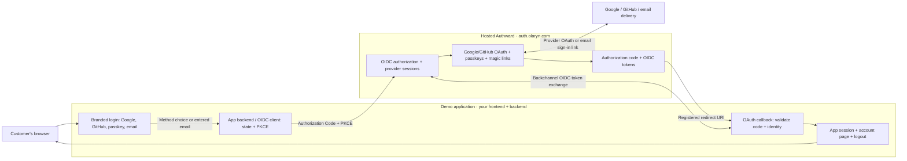

# Authward Demo App

**[Open the live Authward demo](https://authward-demo.pankaj4u4m.workers.dev)** — runs in your browser on Cloudflare Workers; no installation or local Authward server required. Google/GitHub login, email magic links and passkeys are handled by production Authward; the demo owns its login and account UI. Localhost remains supported below.

**A small, product-owned login UI using hosted [Authward](https://auth.olaryn.com) for real authentication.** This is the reference for the Beseam/Trevra integration boundary—not a simulated SaaS application, a second identity provider, or a self-hosted Authward server.

## Who owns what?

| Responsibility | Owner |
| --- | --- |
| Login, signup, email field, provider buttons | **Application** |
| Google/GitHub OAuth execution | **Authward** |
| Email magic-link generation and delivery | **Authward** |
| Authorization code and token issuance | **Authward** |
| OAuth callback and application session | **Application backend** |
| User-facing account page and logout controls | **Application** |

## Architecture



The browser sees **application-owned UI**. The application backend initiates OIDC against hosted Authward, which runs the Google/GitHub identity flow or sends a magic-link email. After the customer actually authenticates, Authward redirects back to the application's registered callback with an authorization code. The backend validates the code, state, nonce, issuer and audience, then creates its own first-party session. Authward credentials and provider secrets never belong in the app.

## Browser demo

Requires Node.js 22+ and a browser running on the same machine:

```bash
git clone https://github.com/olaryn-lab/authward-demo-app.git
cd authward-demo-app
npm ci
npm start
```

Open **http://127.0.0.1:4402**. Choose a login method or enter your email on the demo's login page. The local OAuth client `authward-demo-local` uses the **public** issuer `https://auth.olaryn.com`, the dedicated audience `https://demo.auth.olaryn.com`, an exactly registered loopback callback, and PKCE S256. It has no client secret. The demo uses actual Authward identity, not test credentials or fake sessions.

**Acceptance:** Google/GitHub must reach their real provider, email must request a real magic link from Authward, and completing one method must return to the demo's authenticated account page. Running a browser without completing identity sign-in does **not** prove a successful callback or mail delivery. The app uses in-memory sessions for demonstration only and is **not production-ready middleware**.

## Independent CLI demo

Without running the web server:

```bash
npm ci
node cli.mjs login
```

This is an independent RFC 8628 **device authorization** flow with the separate `authward-demo-cli` public client. The CLI prints an Authward-hosted verification URL and a user code, then waits for user approval. After successful authorization it prints only the verified subject/name/email, never OAuth tokens. No localhost callback, web server or browser sharing the CLI machine is required.

## Integration guide

The full production contract, security guidance, resource-level `interactionBaseUrl` behavior, same-origin CSRF, exact redirect URLs, and OAuth troubleshooting live in [Authward's official documentation](https://auth.olaryn.com/docs) and the [public product integration guide](https://auth.olaryn.com/agent/product-integration-guide.md). Keep secrets in server-side secret storage, and use maintained OIDC libraries rather than reimplementing providers.

## Public live demo on Cloudflare Workers

The [live Cloudflare Worker](https://authward-demo.pankaj4u4m.workers.dev) serves this same product-owned login UI and handles OIDC callback and encrypted sessions for anyone with a browser—without requiring visitors to start a local server. **This is preferable to GitHub Pages**, which cannot run the required backend. The worker uses the same production Authward issuer and a separate **public PKCE client**, so there is **no OAuth client secret** to publish.

The Worker uses a 32-byte random `SESSION_KEY` for AES-256-GCM encrypted, short-lived, HttpOnly + Secure + SameSite=Lax cookie sessions across Cloudflare isolates. This is a **private deployment secret**, not an OAuth client secret; keep it stable between deployments. It also needs its exact public HTTPS `PUBLIC_ORIGIN`. No Cloudflare KV/D1 database is needed for the reference app. A production app should add revocable/durable sessions, monitoring, and abuse controls.

### First-time setup

1. Connect a Cloudflare account with Workers enabled and choose a public URL such as `https://authward-demo.<your-workers-subdomain>.workers.dev`, or an approved custom domain. Avoid inventing a domain before it resolves.
2. Configure the GitHub repository's **`cloudflare-demo`** environment: secrets `CLOUDFLARE_API_TOKEN`, `CLOUDFLARE_ACCOUNT_ID`, `AUTHWARD_DEMO_SESSION_KEY` (a fresh, stable 32-byte base64url key), and variable `AUTHWARD_DEMO_PUBLIC_ORIGIN` (the exact Worker HTTPS origin). Generate a key privately with `node -e "console.log(require('node:crypto').randomBytes(32).toString('base64url'))"`; never commit or paste it into chat.
3. Register a **separate** Authward public browser client `authward-demo-hosted` with the exact Worker callback `<PUBLIC_ORIGIN>/callback`, logout `<PUBLIC_ORIGIN>/`, identity-only audience, and the Worker URL as its product-facing `interactionBaseUrl`. Do **not** change the existing `authward-demo-local` client: its two localhost callback URLs remain usable.
4. Run the GitHub Actions **Publish Authward live demo (Cloudflare Worker)** workflow. It validates the repo, builds the Worker, deploys, installs the existing session key, and checks `/healthz`. You may also run `npm run worker:build` and `npm run worker:dev` locally with your own *ignored* `worker/.dev.vars` file. Do not deploy using unregistered callback origins.
5. Browser acceptance: verify Google/GitHub redirects, real email magic-link receipt and continuation, passkey behavior, the authenticated `/account` callback, consent, logout, and both localhost and hosted flows. A healthy Worker response alone does **not** prove a working login.

The Worker is deployed and configured for `https://authward-demo.pankaj4u4m.workers.dev`; the separate Authward hosted client is registered. The GitHub deployment workflow remains **manual until** a least-privilege Cloudflare API token is installed as `CLOUDFLARE_API_TOKEN` in GitHub Secrets. Local Wrangler can currently deploy through an authenticated Cloudflare session. Then it can be switched to automatic deployments on `main`. The Worker uses its dedicated audience `https://demo-hosted.auth.olaryn.com`; the localhost demo keeps `https://demo.auth.olaryn.com`. A hosted public demo must never use a shared client secret or receive Beseam/Trevra/LemonCrow API scopes.

### What happens after Google/GitHub sign-in?

The demo is a **trusted Authward first-party identity-only client**. Choosing a provider on the demo's own login screen already expresses the user's intent to sign in; Authward does not need to display a redundant third-party approval screen. After successful provider authentication, Authward issues an authorization code to the registered demo callback. The demo verifies PKCE, state, nonce, and the ID token, calls Authward's subject-bound OIDC UserInfo endpoint if the ID token omitted email/name, then shows the authenticated account page with the email address **if Authward provided it**. It never substitutes an unverified email or invents a successful login. **Sign out** clears the demo application session **and** initiates Authward's RP-initiated OIDC logout, terminating the central Authward SSO session. It returns to the demo login page after Authward finishes. This is a central sign-out, so it may affect other applications sharing that Authward session; it does not sign you out of Google or GitHub itself. A subsequent provider login may offer Google/GitHub account selection. The same flow applies to the local browser demo and the live Cloudflare Worker.

A previously issued consent interaction can still be completed safely: the public Worker preserves its pending state and PKCE verifier across a user-bound consent handoff, instead of clearing the entire authentication cookie. This is regression-tested end-to-end with a simulated provider, as actual Google/GitHub or email inbox interaction still requires the real user.

### Sign-out behavior

The demo's **Sign out** is not merely deleting a local cookie. It uses the OIDC `end_session_endpoint` published by production Authward, sends the verified ID-token hint and the exact client-registered `post_logout_redirect_uri`, and clears the application's session. Authward terminates its browser SSO session and returns to the branded demo login page, instead of silently logging you straight back in. On Authward, the next Google sign-in is configured to request account selection. The external Google/GitHub account session is not ended. If an OIDC hint is unavailable (e.g. unusually large token), Authward may show its own logout confirmation rather than ending an unverified browser session.

## Passkey enrollment and sign-in UX

Passkey onboarding begins **inside this application's own UI**, rather than sending customers through the Authward developer workspace:

1. Open `/login` and choose **Continue with Google** or **GitHub** to authenticate once. Email magic link works after the configured email provider accepts delivery.
2. Open your authenticated `/account` and choose **Set up a passkey**. The demo explains where credentials will be saved and what happens next.
3. Choose **Continue to secure passkey setup**. The demo checks your session before redirecting to a dedicated, application-branded `https://auth.olaryn.com/passkeys/enroll?client_id=…` bridge. Authward verifies you are an identity associated with that registered demo client. The passkey ceremony must occur on the actual WebAuthn RP ID (`auth.olaryn.com`) and never on a different product origin.
4. Name the passkey (optional) and approve your device's fingerprint, face, PIN, security-key or password-manager prompt. Upon successful verification the browser returns to `/account?passkey=added`. Cancelling returns to your account without claiming success.
5. **Sign out**, then from the demo `/login` select **Sign in with a passkey**. The product-owned `/passkeys/sign-in` page explains the secure verification step, fallback to another method, and return to your account.

The Authward enrollment bridge is specifically restricted to the two bootstrap-owned demo browser clients and their exact registered callback origins. It does not authorize access to `/developer`, create a workspace, or establish a second account. External integrations should use a supported product-scoped enrollment bridge, not copy a demo-only URL or attempt WebAuthn registration against an unrelated RP ID.

All browser routes have localhost and Cloudflare variants. The public demo URL is [authward-demo.pankaj4u4m.workers.dev](https://authward-demo.pankaj4u4m.workers.dev/). The Authward `/developer` workspace and application pages include **Copy agent instructions**, covering customer-branded passkey enrollment and sign-in, provider OAuth, magic-link errors, callback/UserInfo verification, and OIDC RP-initiated sign-out. The canonical agent-readable reference is [Authward's integration contract](https://auth.olaryn.com/agent/product-integration-guide.md).
