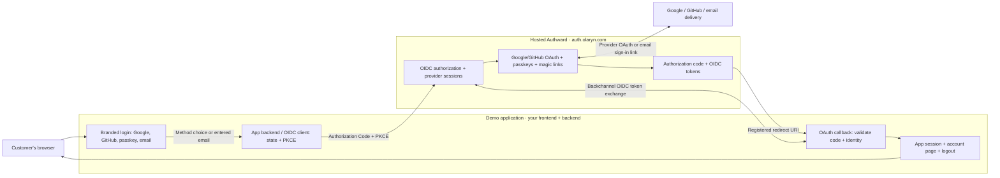

# Authward Demo App

**A small, product-owned login UI using hosted [Authward](https://auth.olaryn.com) for real authentication.** This is the reference for the Beseam/Trevra integration boundary—not a simulated SaaS application, a second identity provider, or a self-hosted Authward server.

## Who owns what?

| Responsibility | Owner |
| --- | --- |
| Login, signup, email field, provider buttons | **Application** |
| Google/GitHub OAuth execution | **Authward** |
| Email magic-link generation and delivery | **Authward** |
| Authorization code and token issuance | **Authward** |
| OAuth callback and application session | **Application backend** |
| User-facing account page and logout controls | **Application** |

## Architecture



The browser sees **application-owned UI**. The application backend initiates OIDC against hosted Authward, which runs the Google/GitHub identity flow or sends a magic-link email. After the customer actually authenticates, Authward redirects back to the application's registered callback with an authorization code. The backend validates the code, state, nonce, issuer and audience, then creates its own first-party session. Authward credentials and provider secrets never belong in the app.

## Browser demo

Requires Node.js 22+ and a browser running on the same machine:

```bash
git clone https://github.com/olaryn-lab/authward-demo-app.git
cd authward-demo-app
npm ci
npm start
```

Open **http://127.0.0.1:4402**. Choose a login method or enter your email on the demo's login page. The local OAuth client `authward-demo-local` uses the **public** issuer `https://auth.olaryn.com`, the dedicated audience `https://demo.auth.olaryn.com`, an exactly registered loopback callback, and PKCE S256. It has no client secret. The demo uses actual Authward identity, not test credentials or fake sessions.

**Acceptance:** Google/GitHub must reach their real provider, email must request a real magic link from Authward, and completing one method must return to the demo's authenticated account page. Running a browser without completing identity sign-in does **not** prove a successful callback or mail delivery. The app uses in-memory sessions for demonstration only and is **not production-ready middleware**.

## Independent CLI demo

Without running the web server:

```bash
npm ci
node cli.mjs login
```

This is an independent RFC 8628 **device authorization** flow with the separate `authward-demo-cli` public client. The CLI prints an Authward-hosted verification URL and a user code, then waits for user approval. After successful authorization it prints only the verified subject/name/email, never OAuth tokens. No localhost callback, web server or browser sharing the CLI machine is required.

## Integration guide

The full production contract, security guidance, resource-level `interactionBaseUrl` behavior, same-origin CSRF, exact redirect URLs, and OAuth troubleshooting live in [Authward's official documentation](https://auth.olaryn.com/docs) and the [public product integration guide](https://auth.olaryn.com/agent/product-integration-guide.md). Keep secrets in server-side secret storage, and use maintained OIDC libraries rather than reimplementing providers.
